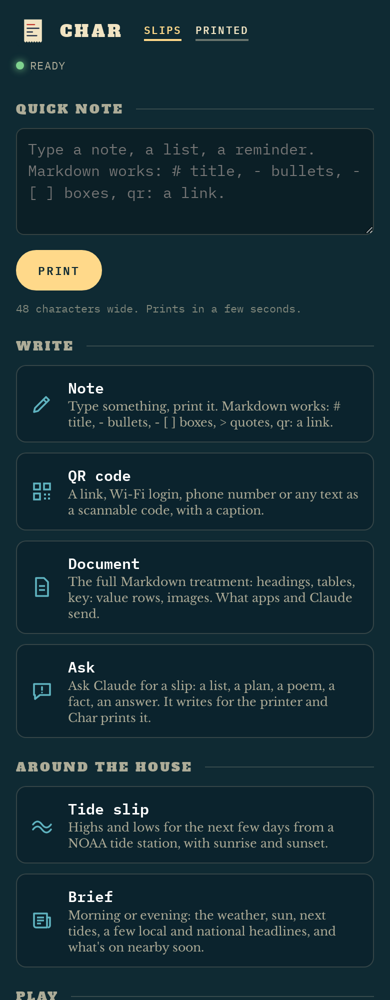
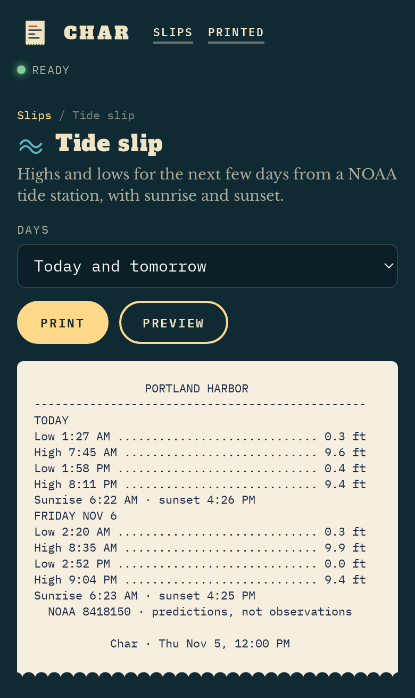
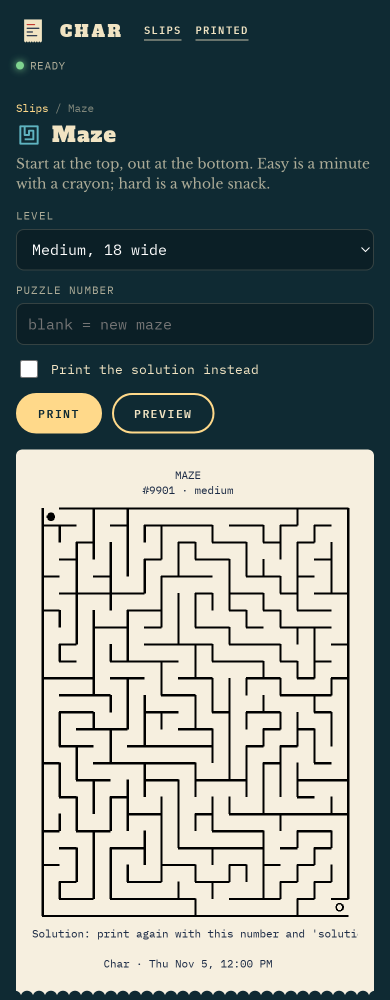
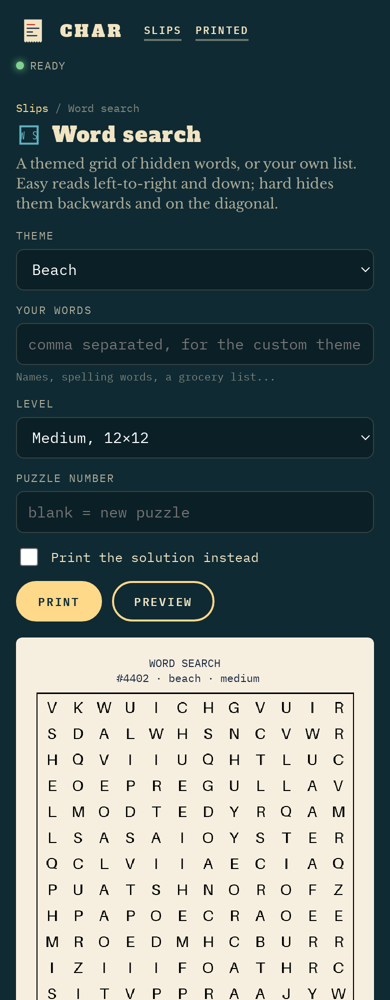

# Char

A small print service for a receipt printer in your kitchen. Char owns one cheap 80 mm thermal printer and lets
everything in the house print to it: a phone, Home Assistant, your own scripts, Pixel Pantry, and Claude.

It prints the useful little things: a morning or evening brief, a shopping list, a recipe strip, a Wi-Fi QR code for
guests, a sudoku, word search or maze for the kids, a joke on a taffy wrapper. Everything happens because someone asked
for it. Nothing prints on a schedule, and nothing calls an AI unless you press Print on a slip that uses one.

Why "Char"? A thermal printer has no ink; it writes by gently charring the paper with heat. And every slip is made of chars.

<p align="center">
  
  
  
  
</p>
<p align="center"><sub>The web app on a phone: every slip has a form and a live preview of the paper. Photos of real slips coming soon.</sub></p>

## Why I made it

I wanted less screen time in the kitchen. A slip of paper on the counter with today's weather, the tide and what's on
this week is something you glance at and get on with your morning, instead of picking up a phone. A printed recipe
doesn't lock, dim, or mind butter. And I wanted it all on my terms: it prints when someone asks, never on its own.

Char is a home project, not a product: MIT licensed, no hosted version, nothing for sale. It pairs nicely with
[Pixel Pantry](https://github.com/timzilla/pixel-pantry), my recipe shelf, and I hope it's useful to someone else with a
receipt printer and a home server.

## What it prints

| Slip | What you get |
|---|---|
| **Note** | Type something, it prints. A little Markdown works: titles, bullets, tick boxes, quotes, `qr:` links. |
| **QR code** | A link, a Wi-Fi login (with the password printed underneath), a phone number or text, as a scannable code. |
| **Document** | The full Markdown treatment: headings, tables, `key:  value` rows, images. What apps send. |
| **Brief** | Morning or evening: the weather, sunrise and sunset, the next tides, a few local and national headlines, and events coming up from your calendars. |
| **Tide slip** | Highs and lows for the next few days from any NOAA tide station. |
| **Recipe** | A recipe from Pixel Pantry with grams and steps, and a QR code back to cook mode on your phone. |
| **House list** | A Home Assistant to-do list (shopping, chores) as a tick-box slip. |
| **Ask** | Ask Claude for a slip: a packing list, a plan, a poem, an answer. It writes for the narrow paper. Optional, your key. |
| **Taffy joke** | A groaner on a wrapper, question on top, answer below. Claude writes fresh ones if you have a key, otherwise it picks from a built-in jar. |
| **Sudoku, Word search, Maze** | Fresh puzzles in three sizes, numbered so you can print the same one again, or its solution. |
| **System slip, Test pattern** | Printer status, and every text style once, for checking the print head and the cutter. |

Modules that need something you haven't set up (Pixel Pantry, Home Assistant, a tide station) simply stay hidden.

## Ways in

- **The web app.** Installable on your phone's home screen. Every slip has a form and a live preview of the paper.
  On Android it's also a share target: share a link, text or photo from any app and it prints (links become QR codes,
  photos are dithered).
- **Home Assistant.** Fire the event `char_print` from any automation, with data like
  `{"markdown": "# Door\nSomeone's at the door"}` or `{"module": "brief", "params": {"edition": "morning"}}`.
  Char keeps a websocket open to Home Assistant, so there's nothing to install on that side.
- **HTTP.** `POST /api/print` with `{"markdown": "..."}`, `{"text": "..."}` or `{"module": "sudoku", "params": {...}}`.
  `GET /api/modules` lists every slip and its settings, `GET /api/jobs/<id>` tells you when it printed.
  For example: `curl -X POST http://char:8096/api/print -H 'Content-Type: application/json' -d '{"markdown":"# Hello\n- from curl"}'`
- **Claude (MCP).** Char is an MCP server at `/mcp` with tools to print Markdown, images and slips.
  In Claude Code: `claude mcp add --transport http char http://<your char>:8096/mcp`.

Every job is kept, so anything can be reprinted from the Printed page. If the printer is off or out of paper, jobs wait
and retry for half an hour.

## Run it

You need Docker on something that's always on, and a network ESC/POS receipt printer. Paste this into Portainer,
Dockge, Unraid's compose manager or a `docker-compose.yml`:

```yaml
services:
  char:
    image: ghcr.io/timzilla/char:latest
    container_name: char
    restart: unless-stopped
    ports:
      - "8096:8000"
    environment:
      TZ: America/Chicago            # your time zone
      CHAR_PRINTER: 192.168.1.50    # the printer's IP address
      # CHAR_TOKEN: ""              # optional: lock Char with a token (see below)
      # ANTHROPIC_API_KEY: ""        # optional: Ask, fresh jokes, Claude-picked headlines
      # CHAR_HA: http://homeassistant.local:8123   # optional: Home Assistant
      # HA_TOKEN: ""                 #   and a long-lived access token
      # CHAR_KITCHEN: http://pixel-pantry:8000     # optional: Pixel Pantry for the Recipe slip
    volumes:
      - ./data:/data                 # the job history
      - ./config:/config             # char.toml and plugins (both optional)
```

Then open `http://<that box>:8096` and print the Test pattern. No printer yet? Leave `CHAR_PRINTER` blank and everything
works except the paper: jobs are kept and you can watch the previews.

For the Brief and the Tide slip, copy [`char.example.toml`](char.example.toml) to `config/char.toml` and set your
latitude and longitude, a NOAA tide station if you're near the coast, and any RSS feeds and calendar (.ics) links you'd
like on the paper. Restart the container after editing it.

Prefer to build it yourself? `git clone https://github.com/timzilla/char.git && cd char && docker compose up -d --build`.

### The printer

Char speaks plain ESC/POS over raw TCP (port 9100), which most networked 80 mm receipt printers do. It prints 576 dots
(48 characters) across, sends images as `GS v 0` raster bands, QR codes as `GS ( k`, and uses a partial cut. It asks the
printer for its status (online, paper, cover) without printing anything.

I've only tested it on one printer, a generic Xprinter-type 80 mm network model. If yours is a different make and
something comes out wrong, please open an issue with the model; the Test pattern slip is the quickest way to show it.
USB and Bluetooth printers aren't supported yet.

### Before you open it up

There's no login by default. Anyone who can reach Char can print, use up your paper, and, if you've added a key,
spend your Anthropic credit through Ask. Keep it on your home network, or put it behind something that asks who you are
(Cloudflare Access, Tailscale, Authelia), or set `CHAR_TOKEN`. With a token set, browsers get a one-time unlock page
and apps send `Authorization: Bearer <token>` (Pixel Pantry has a `CHAR_TOKEN` setting for this; for Claude Code add
`--header "Authorization: Bearer <token>"`).

The phone features (installing it as an app, the share sheet) need HTTPS, same as any web app.

### What it connects to

- **Your printer.**
- **Open-Meteo and NOAA**, only if you've set a location or tide station, only when a Brief or Tide slip is made.
- **The feeds and calendars you list**, when a Brief is made (calendars are cached for 20 hours).
- **Anthropic's API, only if you add your own key**, and only when you print Ask, a fresh joke, or a Brief with headlines.
  Previews never call it.
- **Home Assistant and Pixel Pantry, if you point Char at them.**

That's all. The fonts are in the repo, and there's no analytics and no phoning home.

## Make your own slips

A slip is a small Python class: a name, some fields (the web form, the API and the MCP tool are all built from them),
and a `build()` that returns blocks of text, tables, QR codes and images. Drop a `.py` file in `config/plugins/` and
it's loaded at startup. A plugin with the same name as a built-in slip replaces it, and a plugin can also swap where the
Brief gets its weather, sun and tides (`brief.SOURCES`) or teach it to read an event page with no calendar feed
(`brief.EVENT_KINDS`). `app/modules.py` has plenty of examples, and the block types are listed in `render()` in
`app/escpos.py`.

```python
from modules import Module, Field, register, footer

@register
class Chores(Module):
    name = "chores"; title = "Chores"; blurb = "Today's chores for one kid."; group = "house"; icon = "check"
    fields = [Field("who", "Who", "select", default="sam", options=[["sam", "Sam"], ["alex", "Alex"]])]
    def build(self, p):
        jobs = {"sam": ["Feed the cat", "Unload the dishwasher"], "alex": ["Take out recycling", "Water the plants"]}
        return {"blocks": [{"t": "title", "text": p["who"].title()}, {"t": "checklist", "items": jobs[p["who"]]}] + footer("Chores")}
```

## Under the hood

A FastAPI app in one container, about 2,000 lines. `escpos.py` turns documents into printer bytes and reads the printer's
status; `jobs.py` is a SQLite job queue with one worker feeding the printer; `modules.py`, `brief.py` and `puzzles.py`
are the slips (the puzzles are drawn with Pillow and seeded by the number printed on them); `main.py` is the web app,
the API, the MCP server and the Home Assistant bridge; `config.py` reads the environment and `char.toml`.

## Thanks

Char started from the ideas in [PC-1 Paper Console](https://github.com/travmiller/paper-console) (MIT), re-shaped for a
network printer, a shared home server and phones. Weather from [Open-Meteo](https://open-meteo.com), tides from
[NOAA CO-OPS](https://tidesandcurrents.noaa.gov). Fonts: Alfa Slab One, IBM Plex Mono and Libre Baskerville, all under the
SIL Open Font License (copies in `app/static/fonts/`).

I built this together with Claude Code. It was a lot of fun to make that way.

MIT licensed. Copyright 2026 timzilla.
